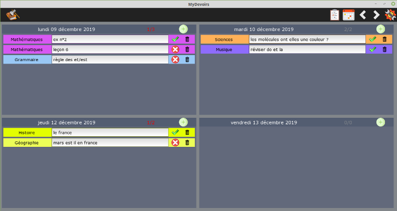
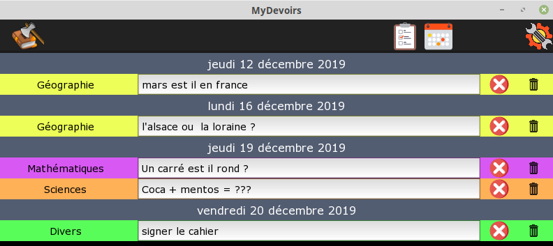
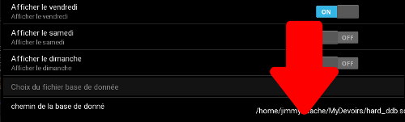
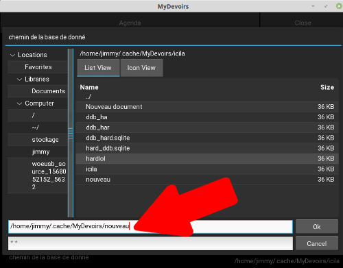
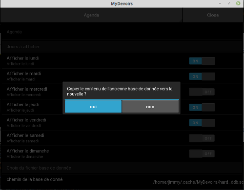
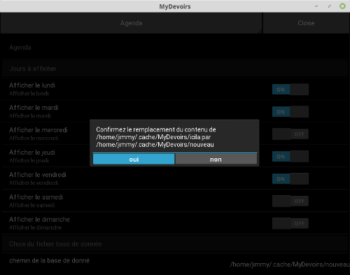
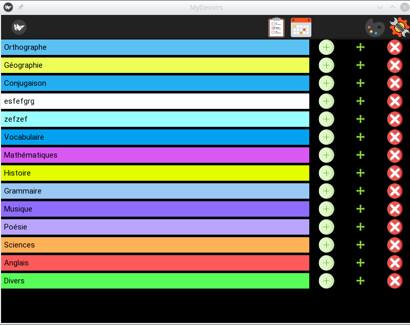
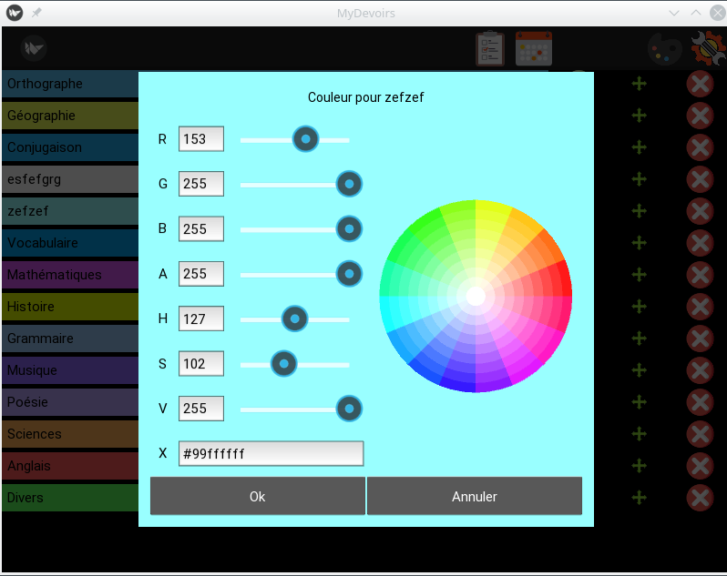

> ⚠️ **Projet repris et maintenu**
>
> Ce dépôt est un fork du projet original [mydevoirs par jgirardet](https://github.com/jgirardet/mydevoirs), qui est maintenant archivé et n'est plus maintenu.
>
> Cette version est activement développée pour corriger les bugs et ajouter de nouvelles fonctionnalités. Pour toute suggestion ou rapport de bug, merci d'utiliser [les formulaires d'issue](#au-secours-jai-un-problème-il-manque-une-fonctionnalité) de ce dépôt.

# MyDevoirs : La prise de devoirs sur ordinateur enfin simple !!!

**[📖 Site de présentation](https://manastria.github.io/mydevoirs/)** · **[⬇️ Télécharger](https://github.com/manastria/mydevoirs/releases/latest)** · **[💬 Signaler un problème](https://github.com/manastria/mydevoirs/issues/new/choose)**





## Pourquoi MyDevoirs ?

Mon fils a un ordinateur à l'école depuis le CM1. Nous avons essayé beaucoup de solutions (rainlendar, onenote, agenda windows...), malheureusement rien de spécialement adapté pour parfaitement coller aux besoins d'un enfant. MyDevoirs a donc été développé spécialement pour lui, en accord avec ses besoins et ses exigences.

## MyDevoirs c'est pour qui ?

A priori les enfants qui ont besoin d'un ordiateur à l'école donc les Dys en général.

## Comment l'installer ?

Pour l'instant disponible sous Windows et Linux.
[Télécharger MyDevoirs](https://github.com/manastria/mydevoirs/releases/latest)

- Version Windows : fichier .msi (installateur)
- Version Linux : fichier .AppImage (exécutable toutes distros)

  - puis sous Windows :

    - executer l'installateur, un raccourci sera créé dans le menu démarrer.

  - puis sous Linux :
    - cliquer sur le fichier mydevoirs.Appimage
    - Il faudra peut être rendre le fichier exécutable soit en mode terminal:
    ```bash
    chmod +x MyDevoirs.appImage
    ```
    ou en mode graphique, par exemple sous Mint : click droit => propriétés => permissions => Autoriser l'exécution du fichier comme un programme.

## Comment l'utiliser ?

Il y a 2 interfaces possibles : Une interface type `agenda`  qui affiche chaque jour de la semaine avec les devoirs de chaque jour, une autre type `todo list` (liste des tâches) . Il semble plus facile de noter ses devoirs dans le mode `agenda`, mais plus simple de faire ses devoirs en mode `todo list`. La `todolist` n'affiche que les devoirs non encore effectués alors que l'`agenda` affiche l'intégralité des devoirs.

Il est possible de modifier les jours affichés et le premier jour de la semaine dans `Paramètres` .

En mode `agenda`, on change de semaine en cliquant sur  pour semaine suivante ou pour semaine précédente. 

### Pour ajouter un devoir:

On clique sur  et on choisit sa matière en cliquant dessus ou avec `entrée`.

La zone de texte est directement sélectionnée, pour entrer le texte correspondant.

### Pour marquer un devoir comme terminé:

On clique sur  qui devient . En mode `todo list`, la ligne disparaît de l'affichage.

### Pour supprimer un devoir:

On clique sur , il faut ensuite confirmer.

## C'est un peu long de reprendre la souris à chaque fois, des raccourcis claviers ce serait bien...

Les raccourcis claviers sont à utliser quand le curseur est dans une zone de texte.

- `Ctrl+D` : (D = dupliquer) Pour créer une nouvelle ligne avec la matière en cours. Pratique quand on veut noter plusieurs choses de la même matière (par exemple leçons, exercices...).

- `Ctrl+M` : (M = Matière) Pour changer la matière en cours. on peut se déplacer avec les `flêches` et valider son choix avec `entrée` ou la `flèche droite`.

- `Ctrl+N` : (N = Nouveau) Pour créer une nouvelle ligne, le choix des matières s'affiche, on choisit avec les `flèches` et on valide par `entrée`.

- `Ctrl+E`: (E = effacer) Pour effacer une ligne.

## Au secours j'ai un problème/ il manque une fonctionnalité

Il suffit de laisser un message sur [Github issue](https://github.com/manastria/mydevoirs/issues/new/choose). Il faut créer un compte github gratuit pour pouvoir laisser un message.

Trois formulaires guidés posent directement les bonnes questions, il n'y a rien de technique à savoir :

| Formulaire | Quand l'utiliser |
| --- | --- |
| [🐞 Signaler un bug](https://github.com/manastria/mydevoirs/issues/new?template=1-bug.yml) | Quelque chose ne marche pas comme prévu, ou le logiciel se ferme tout seul. |
| [✨ Proposer une amélioration](https://github.com/manastria/mydevoirs/issues/new?template=2-fonctionnalite.yml) | Il manque une fonctionnalité, ou un geste du quotidien pourrait être simplifié. |
| [❓ Poser une question](https://github.com/manastria/mydevoirs/issues/new?template=3-question.yml) | Une difficulté d'installation ou d'utilisation, sans savoir si c'est un bug. |

⚠️ La page des issues est publique : n'y mettez aucune information personnelle (nom, prénom, école, adresse électronique, ou tout ce qui permettrait d'identifier un enfant).

## Comment synchroniser MyDevoirs sur plusieurs ordinateurs ?

Il est parfois bien pratique d'avoir un double des devoirs de son enfant sur son propre ordinateur.
L'idée va être de synchoniser le fichier de base de données entre les 2 ordinateurs. Pour cela il faut avoir recours a une service tiers type DropBox, sugarsync, Seafile, Box...
Ensuite il vous suffit de mettre/choisir un fichier dans un dossier qui sera synchronisé entre les différents ordinateurs.

JE PRECISE BIEN QUE CELA PERMET DE SYNCHRONISER/SAUVEGARDER LA BASE DE DONNÉES MAIS EN AUCUN CAS DE TRAVAILLER EN MEME TEMPS.

IL EST DONC IMPORTANT, POUR UN MÊME FICHIER SYNCHRONISÉ, DE N'OUVRIR MYDEVOIRS QUE SUR UNE MACHINE À LA FOIS SINON UN RISQUE DE PERTE DE DONNÉES EST POSSIBLE.

- tout d'abord cliquer sur le chemin actuel dans les paramêtres :



- ensuite sélectionner le répertoire voulu et entrer un nouveau nom de fichier ou en selectionner un. Il est important que le chemin complet du fichier voulu apparaissent dans le zone de nom :



- On vous demande ensuite si vous souhaitez ou non recopier le contenu de la base actuelle dans le nouveau fichier :



- Enfin une ultime confirmation si le fichier selectionné existait déjà :



- et voilà MyDevoirs va redémarrer depuis nouvelle base de données.

## Comment définir des couleurs personnalisées ?

- Cliquer sur la palette .
- l'écran du choix des couleurs s'affiche :



- L'édition se fait de la manière suivante:
  -  permet d'ajouter une matière juste au dessus.
  -  permet de changer l'ordre des matière. Cliquer, maintenir, déplacer la souris, relacher.
  -  pour effacer une matière. ATTENTION la supression d'une matière entraine la supression de tous les devoirs correspondants.
  - Cliquer avec le bouton DROIT sur le texte pour changer de couleur:  
    

## MyDevoirs c'est gratuit ?

MyDevoirs est un logiciel libre (le code source est disponible) sous licence LGPLv3.

## Remeciements

Je remercie tous les gens impliqués dans la réalisation des technologies utlisées et plus particuliérement l'équipe de dévelopeurs de [Kivy](https://www.kivy.org) et [Ponyorm](https://ponyorm.org) pour leur disponibilité pour repondre aux questions.
